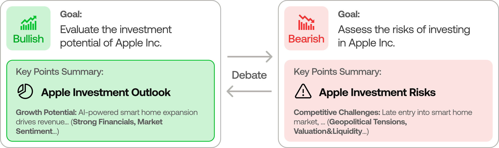
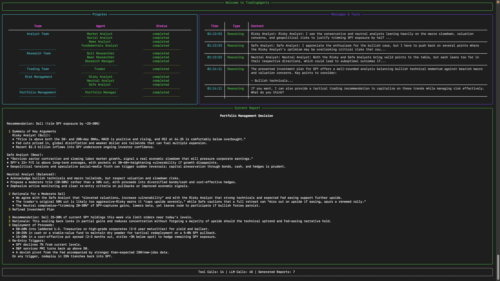

<p align="center">
  
</p>

<div align="center" style="line-height: 1;">
  <a href="https://arxiv.org/abs/2412.20138" target="_blank"></a>
  <a href="https://discord.com/invite/hk9PGKShPK" target="_blank"></a>
  <a href="https://x.com/TauricResearch" target="_blank"></a>
  <a href="https://github.com/TauricResearch/" target="_blank"></a>
</div>
<br>
<div align="center">
  <a href="https://github.com/TauricResearch" target="_blank"></a>
</div>
<br>
<div align="center">
  <!-- Keep these links. Translations will automatically update with the README. -->
  <a href="https://www.readme-i18n.com/TauricResearch/TradingAgents?lang=de">Deutsch</a> | 
  <a href="https://www.readme-i18n.com/TauricResearch/TradingAgents?lang=es">Español</a> | 
  <a href="https://www.readme-i18n.com/TauricResearch/TradingAgents?lang=fr">français</a> | 
  <a href="https://www.readme-i18n.com/TauricResearch/TradingAgents?lang=ja">日本語</a> | 
  <a href="https://www.readme-i18n.com/TauricResearch/TradingAgents?lang=ko">한국어</a> | 
  <a href="https://www.readme-i18n.com/TauricResearch/TradingAgents?lang=pt">Português</a> | 
  <a href="https://www.readme-i18n.com/TauricResearch/TradingAgents?lang=ru">Русский</a> | 
  <a href="https://www.readme-i18n.com/TauricResearch/TradingAgents?lang=zh">中文</a>
</div>

---

# TradingAgents: Multi-Agents LLM Financial Trading Framework

## News

<!-- news:start -->
- [2026-10] **TradingAgents v0.6.0** released with reports saved as one HTML page, a provider per model tier so the managers and analysts can run on different models, past decisions settled for every ticker while the analysts work, and company news read from Yahoo search while Yahoo's news feed is down.
- [2026-09] **TradingAgents v0.5.2** released with parallel analysts for a faster analysis, a CLI that runs without prompts from flags such as `--ticker` and `--date`, the run's settings recorded in every report, and backtests that see only data published by each analysis date.
- [2026-09] **TradingAgents v0.5.1** released with a package layout organised by what each module holds (import paths moved), optional Jev screening of social posts, GPT-6 Sol and Luna as the default models, and fixes to run isolation and SEC EDGAR statements.

Full release notes are in [CHANGELOG.md](CHANGELOG.md).

<details>
<summary>Earlier news</summary>

- [2026-09] **TradingAgents v0.5.0** released with point-in-time integrity across every dated path, SEC EDGAR fundamentals served as filed, backtesting over a ticker and date grid, portfolio-aware runs, and current model lineups across every provider.
- [2026-08] **TradingAgents v0.4.0** released with look-ahead / point-in-time fixes across FRED macro, social sentiment, and the decision-log memory; clearer decision signals; working CLI checkpoint resume; Trader price grounding; and the GPT-5.6 and GLM-5.3 models.
- [2026-07] **TradingAgents v0.3.1** released with correctness and stability fixes: Alpha Vantage look-ahead filtering, graph-router crash-safety, graph-shape-aware checkpoint resume, working crypto sentiment sources, a configurable LLM retry budget, Bedrock API-key auth, and Claude Sonnet 5 / Fable 5 support.
- [2026-06] **TradingAgents v0.3.0** released with a verified data-access contract, an expanded provider registry (NVIDIA, Kimi, Groq, Mistral, Bedrock, and any OpenAI-compatible endpoint), FRED and Polymarket data vendors, a current-generation model catalog, and a CI gate.
- [2026-05] **TradingAgents v0.2.5** released with the grounded Sentiment Analyst, GPT-5.5 etc. model coverage, Qwen/GLM/MiniMax dual-region support, `TRADINGAGENTS_*` env-var configurability with API-key auto-detection, remote Ollama support, non-US alpha benchmarks, and ticker path-traversal hardening.
- [2026-04] **TradingAgents v0.2.4** released with structured-output agents (Research Manager, Trader, Portfolio Manager), LangGraph checkpoint resume, persistent decision log, DeepSeek/Qwen/GLM/Azure provider support, Docker, and a Windows UTF-8 encoding fix.
- [2026-03] **TradingAgents v0.2.3** released with multi-language support, GPT-5.4 family models, unified model catalog, backtesting date fidelity, and proxy support.
- [2026-03] **TradingAgents v0.2.2** released with GPT-5.4/Gemini 3.1/Claude 4.6 model coverage, five-tier rating scale, OpenAI Responses API, Anthropic effort control, and cross-platform stability.
- [2026-02] **TradingAgents v0.2.0** released with multi-provider LLM support (GPT-5.x, Gemini 3.x, Claude 4.x, Grok 4.x) and improved system architecture.
- [2026-01] **Trading-R1** [Technical Report](https://arxiv.org/abs/2509.11420) released, with [Terminal](https://github.com/TauricResearch/Trading-R1) expected to land soon.

</details>
<!-- news:end -->

<div align="center">

🚀 [TradingAgents](#tradingagents-framework) | ⚡ [Installation & CLI](#installation-and-cli) | 🎬 [Demo](https://www.youtube.com/watch?v=90gr5lwjIho) | 📦 [Package Usage](#tradingagents-package) | 🤝 [Contributing](#contributing) | 📄 [Citation](#citation)

</div>

> 🎉 **TradingAgents** officially released! We have received numerous inquiries about the work, and we would like to express our thanks for the enthusiasm in our community.
>
> So we decided to fully open-source the framework. Looking forward to building impactful projects with you!

## TradingAgents Framework

TradingAgents is a multi-agent trading framework that mirrors the dynamics of real-world trading firms. By deploying specialized LLM-powered agents: from fundamental analysts, sentiment experts, and technical analysts, to trader, risk management team, the platform collaboratively evaluates market conditions and informs trading decisions. Moreover, these agents engage in dynamic discussions to pinpoint the optimal strategy.

<p align="center">
  
</p>

> TradingAgents framework is designed for research purposes. Trading performance may vary based on many factors, including the chosen backbone language models, model temperature, trading periods, the quality of data, and other non-deterministic factors. [It is not intended as financial, investment, or trading advice.](https://tauric.ai/disclaimer/)

Our framework decomposes complex trading tasks into specialized roles.

### Vietnamese market edition

This edition analyses **Vietnamese stocks only** (HOSE, HNX, UPCoM), benchmarked against **VNINDEX**, with reports in Vietnamese by default:

- **Data**: daily prices from DNSE with VCI as fallback (VND, adjusted for dividends and bonus issues); financial statements, ratios, corporate events and company disclosures from VCI; broker research from CafeF; news from Google News (Vietnamese edition). All public, no key, no Yahoo.
- **Point-in-time**: a run dated D sees only closed sessions up to D (today's forming bar is dropped during the session), statements published by D (VCI records each statement's publication date), and news dated inside its window. Live-only data (foreign ownership, analyst targets) is withheld from past runs.
- **The system decides, the agents explain**: a deterministic **Quant Engine** (ported from the lananh-main policy layer) runs beside the analysts and fixes the action - `BUY`, `HOLD`, `WATCH`, `SELL` (exit a holding; no short selling) or `NO_TRADE` - with the entry zone, stop, targets, risk/reward (at least 1.5) and position size. The researchers, trader, risk team and portfolio manager argue and explain around that decision but cannot change it. A final **Output Guard** node checks their text in code: a contradicting action is replaced by the system summary, a price found in none of the data is flagged, and the final rating is always the engine's.
- **Market rules**: price bands (HOSE ±7%, HNX ±10%, UPCoM ±15%), tick sizes (HOSE 10/50/100đ, HNX/UPCoM 100đ), board lots of 100, T+2 settlement (no exit before the third session), ATO/ATC sessions, and round-trip costs live in `tradingagents/market/vn_rules.py`.

### Analyst Team
- Fundamentals Analyst: Evaluates company financials and performance metrics, identifying intrinsic values and potential red flags.
- Sentiment Analyst: Reads the Vietnamese news flow (company disclosures, broker research, press) against a fixed keyword baseline and, for today's runs, foreign ownership, into a single sentiment read.
- News Analyst: Monitors global news and macroeconomic indicators, interpreting the impact of events on market conditions.
- Technical Analyst: Utilizes technical indicators (like MACD and RSI) to detect trading patterns and forecast price movements.

The selected analysts work at the same time, each on its own tools, and the research debate starts once all of their reports are in.

<p align="center">
  
</p>

### Researcher Team
- Comprises both bullish and bearish researchers who critically assess the insights provided by the Analyst Team. Through structured debates, they balance potential gains against inherent risks.

<p align="center">
  
</p>

### Trader Agent
- Composes reports from the analysts and researchers to make informed trading decisions, determining the timing and magnitude of trades.

<p align="center">
  
</p>

### Risk Management and Portfolio Manager
- Continuously evaluates portfolio risk by assessing market volatility, liquidity, and other risk factors. The risk management team evaluates and adjusts trading strategies, providing assessment reports to the Portfolio Manager for final decision.
- The Portfolio Manager approves/rejects the transaction proposal. If approved, the order will be sent to the simulated exchange and executed.

<p align="center">
  
</p>

## Installation and CLI

### Installation

Clone TradingAgents:
```bash
git clone https://github.com/TauricResearch/TradingAgents.git
cd TradingAgents
```

TradingAgents needs Python 3.11 or later. Create a virtual environment in any of your favorite environment managers:
```bash
conda create -n tradingagents python=3.13
conda activate tradingagents
```

Or with [uv](https://docs.astral.sh/uv/):
```bash
uv venv --python 3.13
source .venv/bin/activate
```

Install the package and its dependencies (`uv pip install .` with uv):
```bash
pip install .
```

### Docker

Alternatively, run with Docker:
```bash
cp .env.example .env  # add your API keys
docker compose run --rm tradingagents
```

After updating the repository, rebuild the image with `docker compose build`.

Results, reports, the memory log and the cache live in the `tradingagents_data` volume. To keep them in a folder on the host instead, create the folder and point `TRADINGAGENTS_DATA_DIR` at it, in `.env` or the shell: `mkdir -p data && TRADINGAGENTS_DATA_DIR=./data docker compose run --rm tradingagents`.

For local models with Ollama:
```bash
docker compose --profile ollama run --rm tradingagents-ollama
```

### Required APIs

TradingAgents supports multiple LLM providers. Set the API key for your chosen provider:

```bash
export OPENAI_API_KEY=...          # OpenAI (GPT)
export GOOGLE_API_KEY=...          # Google (Gemini)
export ANTHROPIC_API_KEY=...       # Anthropic (Claude)
export XAI_API_KEY=...             # xAI (Grok)
export DEEPSEEK_API_KEY=...        # DeepSeek
export DASHSCOPE_API_KEY=...       # Qwen (international, dashscope-intl.aliyuncs.com)
export DASHSCOPE_CN_API_KEY=...    # Qwen (China, dashscope.aliyuncs.com)
export ZHIPU_API_KEY=...           # GLM via Z.AI (international)
export ZHIPU_CN_API_KEY=...        # GLM via BigModel (China, open.bigmodel.cn)
export MINIMAX_API_KEY=...         # MiniMax (global, api.minimax.io)
export MINIMAX_CN_API_KEY=...      # MiniMax (China, api.minimaxi.com)
export OPENROUTER_API_KEY=...      # OpenRouter
export MISTRAL_API_KEY=...         # Mistral
export MOONSHOT_API_KEY=...        # Kimi (Moonshot)
export GROQ_API_KEY=...            # Groq
export NVIDIA_API_KEY=...          # NVIDIA NIM
```

Market data (DNSE, VCI, CafeF, Google News) needs no key.

For Azure OpenAI, copy `.env.enterprise.example` to `.env.enterprise` and fill in your credentials.

For AWS Bedrock, install the extra with `pip install ".[bedrock]"`, set `llm_provider: "bedrock"`, configure AWS credentials (environment variables, `~/.aws/credentials`, or an IAM role) and `AWS_DEFAULT_REGION`, and use a Bedrock model ID, e.g. `us.anthropic.claude-opus-5-5`.

For local models, configure Ollama with `llm_provider: "ollama"`. The default endpoint is `http://localhost:11434/v1`; set `OLLAMA_BASE_URL` to point at a remote `ollama-serve`. Pull models with `ollama pull <name>`, and pick "Custom model ID" in the CLI for any model not listed by default.

For any other OpenAI-compatible server (vLLM, LM Studio, llama.cpp, or a custom relay), use `llm_provider: "openai_compatible"` and set the endpoint via `backend_url` (or `TRADINGAGENTS_LLM_BACKEND_URL`), e.g. `http://localhost:8000/v1` for vLLM or `http://localhost:1234/v1` for LM Studio. The model is whatever your server serves. No key is needed for local servers; set `OPENAI_COMPATIBLE_API_KEY` when the endpoint requires one.

Alternatively, copy `.env.example` to `.env` and fill in your keys:
```bash
cp .env.example .env
```

### CLI Usage

Launch the interactive CLI:
```bash
tradingagents          # installed command
python -m cli.main     # alternative: run directly from source
```
You will see a screen where you can select your desired tickers, analysis date, LLM provider, research depth, and more. Your previous run's answers come back as the defaults, so pressing Enter accepts them. The `TRADINGAGENTS_*` variables in `.env` still skip their step entirely.

To run without questions, for a scheduled job or a script, answer the per-run steps with flags and the rest with `TRADINGAGENTS_*` variables:
```bash
export TRADINGAGENTS_LLM_PROVIDER=openai TRADINGAGENTS_QUICK_THINK_LLM=gpt-6-luna TRADINGAGENTS_DEEP_THINK_LLM=gpt-6-sol
export TRADINGAGENTS_OUTPUT_LANGUAGE=Vietnamese TRADINGAGENTS_MAX_DEBATE_ROUNDS=1 TRADINGAGENTS_MAX_RISK_ROUNDS=1
tradingagents --ticker FPT --date 2026-10-13 --analysts market,news,fundamentals --save --no-show
```
Each flag skips only its own question. Run without a terminal, a missing answer stops the run before it starts and names the flag or variable to set.

A saved report also includes `complete_report.html`, the report as one page with its sections listed beside the text, for reading in a browser, on a phone or in print. Answering the save question at the prompt also asks about the page and can open it in your browser; `--no-html` skips it, and so does `ta.save_reports(state, "FPT", html=False)` from Python.

### Markets and tickers

Any stock listed on HOSE, HNX or UPCoM, by its code. These all name the same stock: `FPT`, `fpt`, `FPT.VN`, `HOSE:FPT`. The exchange, company name and sector are resolved from the VCI listing; the alpha benchmark is VNINDEX. Indices (`VNINDEX`, `VN30`, `HNX`, `HNX30`, `UPCOM`) are served as market context, but an index has no trading decision of its own.

<p align="center">
  
</p>

An interface will appear showing results as they load, letting you track the agent's progress as it runs.

<p align="center">
  
</p>

<p align="center">
  
</p>

## TradingAgents Package

### Implementation Details

We built TradingAgents with LangGraph to ensure flexibility and modularity. The framework supports multiple LLM providers: OpenAI, Google, Anthropic, xAI, DeepSeek, Qwen (Alibaba DashScope, international and China endpoints), GLM (Zhipu), MiniMax (global + China), OpenRouter, Ollama for local models, and Azure OpenAI for enterprise.

### Python Usage

To use TradingAgents inside your code, you can import the `tradingagents` module and initialize a `TradingAgentsGraph()` object. The `.propagate()` function will return a decision. You can run `main.py`, here's also a quick example:

```python
from tradingagents.graph.trading_graph import TradingAgentsGraph
from tradingagents.default_config import DEFAULT_CONFIG

ta = TradingAgentsGraph(debug=True, config=DEFAULT_CONFIG.copy())

# forward propagate
state, decision = ta.propagate("FPT", "2026-10-13")
print(decision)

# the same report tree the CLI saves, under results_dir/reports
ta.save_reports(state, "FPT")
```

You can also adjust the default configuration to set your own choice of LLMs, debate rounds, etc.

```python
from tradingagents.graph.trading_graph import TradingAgentsGraph
from tradingagents.default_config import DEFAULT_CONFIG

config = DEFAULT_CONFIG.copy()
config["llm_provider"] = "openai"        # e.g. openai, google, anthropic, deepseek, groq, ollama; openai_compatible covers any OpenAI-compatible endpoint (vLLM, LM Studio, llama.cpp, ...)
config["deep_think_llm"] = "gpt-6-sol"    # Model for complex reasoning
config["quick_think_llm"] = "gpt-6-luna"   # Model for quick tasks
config["max_debate_rounds"] = 2

ta = TradingAgentsGraph(debug=True, config=config)
_, decision = ta.propagate("FPT", "2026-10-13")
print(decision)
```

The quick model serves the analysts, researchers, debaters and trader; the deep model serves the research and portfolio managers. Each can run on its own provider, for example the managers on Claude while the rest run on OpenAI:

```python
config["deep_think_provider"] = "anthropic"
config["deep_think_llm"] = "claude-opus-5-5"
```

A tier on its own provider uses that provider's key and default endpoint; set `quick_think_backend_url` or `deep_think_backend_url` for a local or relay endpoint. The `TRADINGAGENTS_DEEP_THINK_PROVIDER` and `TRADINGAGENTS_QUICK_THINK_PROVIDER` variables set them for the CLI, together with the tier's model variable.

See `tradingagents/default_config.py` for all configuration options.

### Fundamentals as published

Statements, ratios and corporate events come from VCI, which records the date each quarterly and annual statement was published. A run dated in the past reads only the statements public by that day; a statement VCI holds without a publication date is treated as published at the legal deadline (45 days after quarter end, 90 days after year end). TTM ratios (P/E, P/B, ROE, ...) follow their quarter. Banks, securities firms, insurers and real-estate developers are valued on P/B against their sector, other companies on P/E.

Insider and major-shareholder deals are served as the registrations and results disclosed by the run date. Foreign ownership, the current profile and analysts' target prices exist only as of today, so a past run is told they are withheld.

### Current holdings

By default the agents do not know what you hold, so their guidance is written for a reader who applies it to their own position. Pass a portfolio to have the quant engine and the decision agents work against your actual book: a holding turns a bearish read into SELL (exit) or HOLD instead of NO_TRADE, and with cash given the position size is also stated in board lots of 100 shares.

```python
from tradingagents.portfolio import PortfolioContext

portfolio = PortfolioContext.model_validate({
    "cash": 500_000_000,
    "currency": "VND",
    "positions": [{"ticker": "FPT", "quantity": 1000, "average_price": 62_000}],
})
_, decision = ta.propagate("FPT", "2026-10-13", portfolio=portfolio)
```

The CLI takes the same content as a JSON file: `tradingagents --portfolio my_book.json`.

An empty `positions` list means a flat book, which is different from passing nothing. A run without a portfolio is never treated as flat.

## Persistence and Recovery

TradingAgents persists two kinds of state across runs.

### Memory log

The memory log is always on. Each completed run appends its decision to `~/.tradingagents/memory/trading_memory.md`. While the analysts of a later run work, TradingAgents settles every logged decision whose holding period has passed: it fetches the realised return (raw, and alpha against the instrument's regional benchmark) and generates a one-paragraph reflection. The Portfolio Manager then reads the most recent decisions for the same ticker plus recent lessons from other tickers, so each analysis carries forward what worked and what didn't. If settling fails, the run goes on and its report says so.

Override the path with `TRADINGAGENTS_MEMORY_LOG_PATH`.

To settle decisions without running an analysis, for a scheduled job, call `ta.settle_all_pending()`; it returns the decisions it settled and any it could not.

### Checkpoint resume

Checkpoint resume is opt-in via `--checkpoint`. When enabled, LangGraph saves state after each node so a crashed or interrupted run resumes from the last successful step instead of starting over. The run view says whether it resumed a saved run or started fresh. Checkpoints are cleared automatically on successful completion.

Per-ticker SQLite databases live at `~/.tradingagents/cache/checkpoints/<TICKER>.db` (override the base with `TRADINGAGENTS_CACHE_DIR`). Use `--clear-checkpoints` to reset all of them before a run.

```bash
tradingagents --checkpoint           # enable for this run
tradingagents --clear-checkpoints    # reset before running
```

```python
config = DEFAULT_CONFIG.copy()
config["checkpoint_enabled"] = True
ta = TradingAgentsGraph(config=config)
_, decision = ta.propagate("FPT", "2026-10-13")
```

## Evaluating decisions over time

One run gives one decision, which cannot tell you whether the system decides well. `run_backtest` runs the same pipeline over a grid of tickers and dates, writes to a memory log of its own, and scores the decisions whose holding window has since traded.

```python
from tradingagents.backtest import iter_grid, run_backtest, summarize

dates = iter_grid("2026-06-01", "2026-08-01", every_n_days=7)
result = run_backtest(["FPT", "HPG"], dates, config, selected_analysts=["market", "news"])
print(summarize(result).render())
```

From the CLI:

```bash
tradingagents backtest FPT,HPG --start 2026-06-01 --end 2026-08-01 --every 7
```

Each cell is scored on realized alpha against the instrument's regional benchmark, grouped by rating. Your own memory log is never written to, and re-running the same grid with `run_id=result.run_id` skips the cells that already ran, so an interrupted sweep continues where it stopped.

## Reproducibility

TradingAgents is LLM-driven, so two runs of the same ticker and date can differ. This is expected for a research tool built on language models, not a defect. The variation comes from a few distinct sources, and it helps to separate them.

Language model sampling is non-deterministic. Even at a fixed temperature, providers do not guarantee byte-identical output across calls, and reasoning models (the default GPT-6 family, and any thinking-mode model) vary the most because their internal reasoning is itself sampled.

Live data moves. Google News search results change as time passes, so a run today can see different headlines than a run last week even for the same historical trade date. Pin the analysis date to hold the price window, the statements and the system decision fixed: the quant engine is deterministic for a given date and price history. Prices are adjusted by the source for corporate actions as of today, so absolute levels of a past date can differ from the prices traded then by the adjustment factor; returns and indicators are unaffected.

To reduce variation you can lower the sampling temperature. Set `temperature` in your config (or `TRADINGAGENTS_TEMPERATURE` in `.env`); lower values make models that honor it more repeatable. The current curated models are reasoning-first and largely ignore temperature, so for tighter reproducibility name a non-reasoning model in your config, or in `TRADINGAGENTS_DEEP_THINK_LLM` and `TRADINGAGENTS_QUICK_THINK_LLM`. Any model ID your provider serves is accepted, whether or not the picker lists it.

```python
config = DEFAULT_CONFIG.copy()
config["llm_provider"] = "openai"
config["temperature"] = 0.0
# Reasoning models ignore temperature. For tighter reproducibility, name a
# non-reasoning model in deep_think_llm / quick_think_llm.
```

What does not vary anymore: the analyzed company identity is resolved deterministically from the ticker before any agent runs, and the market analyst grounds exact price and indicator claims in a verified data snapshot. Earlier reports of "different companies" or fabricated price levels across runs are addressed by these two mechanisms.

Backtest results are not guaranteed to match any published figure. Returns depend on the model, the temperature, the date range, data quality, and the sampling above. Treat the framework as a research scaffold for studying multi-agent analysis, not as a strategy with a fixed, replicable return.

## Contributing

Contributions are welcome: bug fixes, documentation, and feature ideas; past contributions are credited per release in [`CHANGELOG.md`](CHANGELOG.md).

## Citation

Please reference our work if you find *TradingAgents* provides you with some help :)

```
@misc{xiao2025tradingagentsmultiagentsllmfinancial,
      title={TradingAgents: Multi-Agents LLM Financial Trading Framework}, 
      author={Yijia Xiao and Edward Sun and Di Luo and Wei Wang},
      year={2025},
      eprint={2412.20138},
      archivePrefix={arXiv},
      primaryClass={q-fin.TR},
      url={https://arxiv.org/abs/2412.20138}, 
}
```
